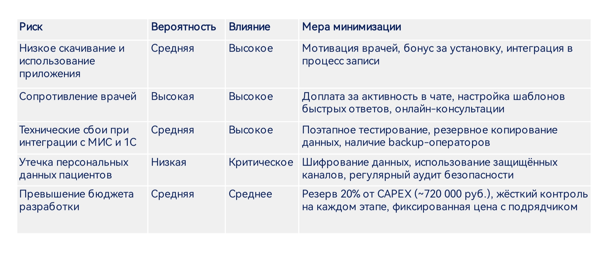

# Риски и KPI проекта

## Реестр рисков

*Вывод: Проект имеет приемлемый уровень риска. Наиболее вероятный риск — сопротивление врачей. Все риски контролируемы при поэтапном внедрении.*

## Целевые KPI (через 2 года после внедрения)

| Показатель | Было (до внедрения) | Цель (после) | Метод измерения |
| :--- | :--- | :--- | :--- |
| **Выручка** | 297,3 млн руб. | 330 - 350 млн руб. | Финансовая отчетность (1С) |
| **Доля повторных визитов** | 45% | 55-60% | CRM-система / МИС |
| **Уровень неявок на прием** | ~15% | 8-10% | Отчеты администраторов |
| **Время записи на прием** | 5-7 мин (по телефону) | 1 мин (в приложении) | Аналитика мобильного приложения |
| **Количество активных пользователей (MAU)** | 0 | 15 000 - 20 000 | Аналитика мобильного приложения |
